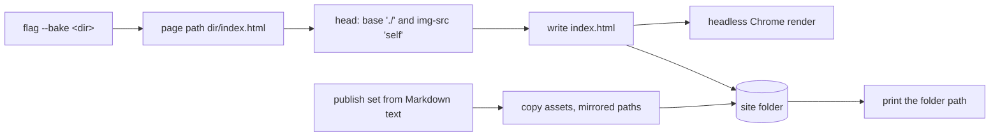

# Gate: bake-pages

_For the owner, who reads this instead of the code. One page per section. The model writes "Before build" before any task starts, and "At merge" at close-out; both go at the top of the PR._

## Before build

### What it builds

One command makes a folder you can upload. `md-view --bake site docs/index.md`
writes `site/index.html` with every Markdown file of the tree. It also copies
each picture and linked file that the Markdown names. The tool prints the
folder and opens nothing.

You share one address: the folder address. A reader who wants one file opens the folder address with `#/docs/guide/intro.md` after it.

### Parts it touches



### Contracts, data and runtime

| Contract | Change |
|---|---|
| Flag | `--bake` now takes a folder: `--bake <dir>`. No value → exit 2. With `--out` → exit 2. The folder must exist. |
| Output | `<dir>/index.html` plus assets at their root-relative paths, for example `site/guide/img/logo.png`. |
| Page head | Baked pages use `<base href="./">` and `img-src data: 'self'`. Other pages keep `img-src data: file:`. |
| Published assets | Only the targets that the Markdown names. Pictures need one of these endings: `png`, `jpg`, `jpeg`, `gif`, `svg`, `webp`. Linked files take any ending. A target passes when no path part starts with a dot and no part is `node_modules`. No byte is below `0x20`, and the depth stays within `tree_depth`. |
| stdout | The absolute folder path, one line, exit 0. No browser starts. |
| Runtime | No new tool. Headless Chrome stays a build-time tool for the bake path. Mermaid comes from `cdn.jsdelivr.net`, at bake time now, so a hosted page needs no network for its diagrams. |

### Words this page uses

| Word | Meaning |
|---|---|
| bake | Write a page (and its files) that need no build step at the viewer. |
| tree | The Markdown files under one root folder, shown in the panel on the left. |
| root | The folder the tree walks: the folder of the opened file, or the nearest `.git` folder upward. |
| `page` file | A tree file small enough to sit inside the page. |
| publish set | The assets a baked folder gets: the targets the Markdown names, and the tree rules accept. |
| tree-scan skip rules | The rules the tree list uses: skip a dotted name, `node_modules`, a control byte, and a depth over `tree_depth`. |
| `tree_depth` | The key in `config.ini` for that depth, 6 by default. |
| head | The `<head>` of the page: the meta lines, the base, the styles. |
| hash route | The part of the address after `#`. It picks the file and the place in it. |
| `index.html` | The file a web server serves for a folder address. |
| page script | `lib/page.js`, the code that renders the text in the browser. |
| vendored | A third-party file that the repo carries and the page inlines. |
| cache page | The page in `$XDG_CACHE_HOME/md-view/`, reused when nothing changed. |
| SharePoint preview | The one-up preview that puts a file in an `<iframe>` and parses scripts inert. |
| `cdn.jsdelivr.net` | The one remote script, for mermaid. |
| stdout | The lines a command prints as its result, not as a warning. |

### Decisions the model made

| Decision | Alternative rejected | Why |
|---|---|---|
| One `index.html` with the whole tree, assets mirrored | One `.html` per Markdown file, plus a name manifest | One upload, no name rewriting, and the existing `#/route` nav keeps working |
| `img-src data: 'self'` | Add `https:` to the CSP | Keeps the remote-image block rule; a remote picture shows broken, so the author puts the file next to the Markdown |
| Gate the publish set with the tree-scan skip rules | Copy every link target | Untrusted Markdown can name `.env` or `.git/config`; the scan rules are the set a tree page already shows |
| Always build a baked page | Reuse the cache freshness check | The asset set has no freshness rule, and a folder rebuild is cheap |
| Keep the headless-Chrome render | Drop the render, ship the live page | The render is what makes a script-free preview (SharePoint) show text, code and diagrams |
| `--bake <dir>` as a value-taking flag | `--bake pages` plus a bare `--bake` | One shape to learn; the de-scope removed the per-file pages mode that needed the value name |

### How you'll see it working

```sh
make install PREFIX=$PWD/.build/prefix
.build/prefix/bin/md-view --bake /tmp/site docs/architecture
python3 -m http.server -d /tmp/site 8081
```

Open <http://localhost:8081/>. The tree panel lists the spec files, the pictures show, and a click on a file changes the address to `#/md-view.spec.md`. `ls -R /tmp/site` shows `index.html` and the copied assets.

### A fresh reader's paraphrase

**What this builds**

One command — `md-view --bake site docs/index.md` — produces a self-contained
upload folder: a single `index.html` that carries the whole Markdown tree, plus
every picture and linked file that the Markdown names, copied in at their own
relative paths. The tool prints the folder path and opens no browser. A reader
gets one address, the folder address; to read one file they append a hash route
like `#/docs/guide/intro.md`. The output needs no network for its diagrams.

**How the parts fit, per this page**

The `--bake <dir>` flag sets the page path to `dir/index.html`; the head step
gives that page a `./` base and an `img-src` of `'self'`; the headless-Chrome
render bakes the live DOM into the file, and the write puts it in the site
folder. In parallel, the publish set — the targets read from the Markdown text —
is copied into the same folder under mirrored paths. The folder's absolute path
is the last thing printed. Per the Contracts table, the flag takes a required
value, is exclusive with `--out`, and needs an existing folder; the asset filter
(dot-parts, `node_modules`, control bytes, `tree_depth`) gates what is copied.

_From the fresh read of 2026-11-20. The page defines the terms it uses under
"Words this page uses"; the open choices the reader listed are settled in
`plan.md` under "Settled by the fresh read"._

## At merge

### What was built

Same as "What it builds", plus one thing. The baked page carries the rendered
text, the code colors, and the diagrams from one headless-Chrome pass. Its image
addresses point into the folder (`./…`), not at the author's disk.

### Decisions changed during the build

One row changed. "Chrome render kept as-is" now also rewrites each
`file://<bake folder>/` prefix in the dump to `./`. The live page script writes
absolute image addresses into the DOM; the old bake kept them, so a remote reader
saw broken images.

### What the reviews caught

- Important: the baked page kept absolute `file://` image addresses. The dump
  rewrite (above) fixed it.
- A target with `%25` decoded twice. The decoder now advances one escape at a
  time.
- A target with parentheses, for example `Screenshot (1).png`, was not
  published. The inline pattern takes one nesting level now.
- A Markdown file with CRLF lines lost its last named asset on each line. The
  extractor strips a trailing `\r` first.
- Tree-mode bake had no test row, and two fixture files went unused. One row
  covers both.
- The mermaid check needed the network and only skipped when Chrome was absent.
  A fetch probe now gates it.
- Docs: the copy order in the plan, the leading-slash rule in the spec, the two
  bake environment knobs, and the stale pages-mode rows in the story.
- Fenced code blocks published fake targets, for example a `target` file from
  the spec's prose. The extractor now skips fence lines and the block they open.
- A link to a name with no file aborted the bake with exit 2. A missing target
  now prints `md-view: no file for <target>` and the bake exits 0.

### Run it

`md-view --bake site docs/index.md` prints the absolute path of `site` and opens
nothing. `site/index.html` shows the whole tree; `site/guide/img/logo.png` sits
under the same address. Serve it with `python3 -m http.server -d site` and open
`http://localhost:8000/`; add `#/docs/guide/intro.md` to read one file. The page
needs no network for text, code, diagrams, and pictures.

