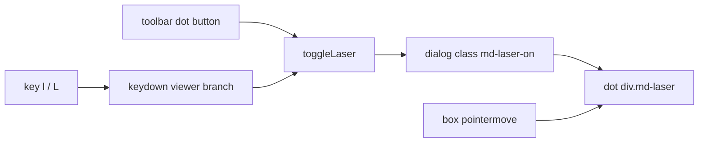

# Gate: diagram-laser-pointer

_For the owner, who reads this instead of the code. One page per section. The model writes "Before build" before any task starts, and "At merge" at close-out; both go at the top of the PR._

## Before build

### What it builds

The fullscreen diagram viewer gets a laser pointer: a red dot follows the pointer over the diagram. A presenter uses it to point at a part of the diagram. A `●` toolbar button and the key `l` (or `L`) turn it on and off. It stays on across close and reopen in the page.

### Parts it touches

### Contracts, data and runtime

No new `localStorage` key. New CSS classes `md-laser` (the dot) and `md-laser-on` (the dialog, set while the laser is on). The viewer toolbar grows a `●` button (`aria-label` `Laser pointer`, `aria-pressed` reflects the state) between `1:1` and `×`. The viewer key set gains `l`/`L`. State lives on the in-memory viewer object; a reload resets it.

### Decisions the model made

| Decision | Alternative rejected | Why |
|---|---|---|
| Dot anchored to the dialog, position from the dialog rect | anchor to `.md-vbox` (content-relative) | the dot must sit under the pointer, not scroll with the diagram |
| Toggle-on centers the dot at the center of the visible box | dialog corner, or the scrollable content's center | the dot marks where the audience sees, before any pointer move |
| Dot carries `z-index: 1` | plain source order | a fixed rule paints above the box at every zoom, no browser observation needed |
| Button carries `title` as well as `aria-label` (the `viewerButton` helper already sets both) | aria-label only | free tooltip, no extra code |
| Two tasks: page code, then test+docs | one task | the test row needs the final markup; keeps each brief small |

### How you'll see it working

Open a Markdown file with a diagram (`md-view README.md`). Click the diagram (or its `⤢` bar) to open the viewer. Press `l`: a red dot appears at the center and follows the pointer over the diagram. `●` in the toolbar does the same. Drag still pans, wheel still zooms.

### A fresh reader's paraphrase

**What this builds.** This story adds a laser pointer to the fullscreen diagram viewer: a red dot that follows the pointer over a diagram, so a presenter can point at a part of it during a talk. A `●` button in the viewer toolbar and the key `l` (or `L`) turn the laser on and off. The on/off state lives in memory: it survives closing and reopening the viewer within one page load, and a reload resets it. The dot anchors to the dialog, so it tracks the pointer itself rather than scrolling with the diagram content.

**How the parts fit, per this page.** Two inputs converge on a single toggle function, `toggleLaser`: the toolbar button calls it, and a new case in the viewer's existing keydown branch calls it for `l`/`L`. Toggling puts the class `md-laser-on` on the viewer dialog, and that class controls the visibility of the dot element (a `div` with class `md-laser`, painted above the diagram via `z-index`). The dot's position is driven by the box's existing `pointermove` listener, and on toggle-on it centers at the visible box center so the audience sees a mark before any pointer move. Panning (drag) and zooming (wheel) keep working while the laser is on. State lives on the in-memory viewer object — no new `localStorage` key — and the button's `aria-pressed` mirrors the state.

_(Fresh read 2 of 2: all sections paraphrase cleanly, no gaps; verdict "docs clear for build". The three remaining open choices are implementer-level: test coordinates, poll cadence, commit subjects.)_

## At merge

### What was built

{{against "What it builds": same, more, or less, and why}}

### Decisions changed during the build

{{rows changed or added in the table above, with the reason; or "none"}}

### What the reviews caught

{{the findings that changed code, one line each; or "nothing that changed code"}}

### Run it

{{the command or demo, and what you should see}}
