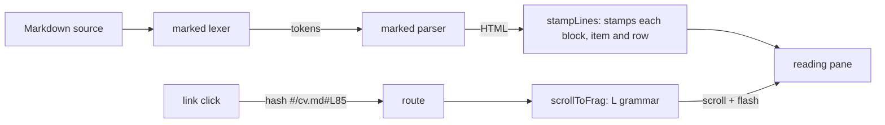

# Gate: line-anchor-nav

_For the owner, who reads this instead of the code. One page per section. The model writes "Before build" before any task starts, and "At merge" at close-out; both go at the top of the PR._

## Before build

### What it builds

A link with a line number opens the file at that line. In your interview plan, `["CPU at peak..."](cv.md#L85)` now opens cv.md at the exact list item from line 85, and flashes it. Ranges `#L85-90` and `#L85-L90` jump to the start of the range and flash every item inside it.

### Parts it touches

### Contracts, data and runtime

- The page fragment `#FRAG` gains two accepted shapes: `L<n>` (a line) and `L<n>-<m>` / `L<n>-L<m>` (a range). Heading slugs work as today. Old links keep working.
- Rendered elements gain two attributes: `data-line="<n>"` and `id="L<n>"` on every top-level block, every list item (any nesting), and every table row.
- The page gains one CSS rule, `.markdown-body .md-line-target`, a soft yellow flash (light and dark theme). The page script sets and clears the class; no timed animation.
- No new tools, no vendored-file change, no config key. `marked.lexer` + `marked.parser` replace `marked.parse` in the render step; the output HTML is the same (measured).

### Decisions the model made

| Decision | Alternative rejected | Why |
|---|---|---|
| Land on the last stamped element at or below the line | Require an element that starts exactly at the line | GitHub's behavior; a quote line inside a paragraph must land on that paragraph. |
| Grammar is case-sensitive: `L` only | Accept `l85` too | GitHub is case-sensitive; one spelling keeps the spec row short. |
| Stamp both `id="L85"` and `data-line="85"` | Stamp only `data-line` | The id lets a one-file page's native fragment jump work beside the script; `data-line` drives the landing search. |
| The flash stays until the next landing | A timed fade-out | No timer to tune; the DOM dump proves the class for the test. |
| Fixed flash color `light-dark(#fff8c5, rgba(187,128,9,.35))`, scoped `.markdown-body .md-line-target` | A palette-driven accent; a bare `.md-line-target` selector | The flash is a transient mark, not theme content; GitHub uses one yellow. The `!important` on its color makes it win over the table stripes, the Tokyo palette rules and the code and rule rules. The scoped selector alone does not: those rules are more specific. |
| A range marks every stamped element inside it | Mark only the landing element | The range is a quote of several items; all of them are the quote. |
| Stamp table rows at `<tr>`, header row at the table's start | Stamp each `<td>` | A row is the unit a quote points at; cells double the stamp count for no gain. |
| Stamps run on every render, no cache | Cache stamps per file | `show()` rebuilds the DOM on every route change; cached nodes would be detached. Lex is cheap at the 8 MiB cap; measure in T1, cache only if slow. |

### Terms on this page

- stamp: write a source line number onto an element, as `data-line` and `id`.
- quote: a link that cites a line of another file, like the `cv.md#L85` links in plan.md. Landing (land on): the element a line anchor scrolls to.
- reading pane: the content area (`#content`) that shows the current file. Route (hash route): the page's URL hash picks the file and anchor; see the Route row in the spec. `#FRAG`: the anchor part of that hash.
- `show()`: the function in `lib/page.js` that renders one file into the reading pane. `md-view`: this tool; run it with `sh bin/md-view <file>`.
- marked: the vendored Markdown engine (`lib/marked.min.js`). `.markdown-body`: the class the vendored GitHub stylesheet (`lib/github-markdown-*.css`) puts on the rendered Markdown. Vendored files: the nine third-party `lib/` files with their licenses.
- palette-driven accent: the page setting that tints diagrams from a palette (`palette=` in the config). 8 MiB cap: the spec's limit on the page text.
- T1, T2, T3: task labels in `plan.md`. `dom_line_*` rows: the new test cases in `tests/browser-links-dom.sh`, named like the existing `dom_*` cases.
- cv.md, plan.md: example file names. The quotes on this page point at them; they are not in this repo.

### How you'll see it working

Run `md-view plan.md` in a folder that also holds `cv.md`. Then click a `cv.md#L85` quote. cv.md opens scrolled to the list item from line 85, with a yellow flash.

Test rows: `sh tests/browser-links-dom.sh` (at least 11 new `dom_line_*` rows).

### A fresh reader's paraphrase

md-view gains line-number links. A Markdown link can end in a fragment that names a source line, for example `["CPU at peak…"](cv.md#L85)`. The file opens scrolled to the rendered element made from that line. That element is highlighted. A range fragment (`#L85-90` or `#L85-L90`) lands at the range's start element and highlights every stamped element inside the range. This is additive: existing heading-slug anchors and old links keep working, because the line shapes are two new accepted forms of the page's `#FRAG`.

Rendering is a chain the page reruns on every route change: Markdown source -> marked lexer -> tokens -> marked parser -> HTML -> a new `stampLines` step. It writes the source line number (`data-line` and `id="L<n>"`) onto each top-level block, list item, and table row before the nodes reach the reading pane. Clicking a link changes the hash route (`#/cv.md#L85`). The route drives `scrollToFrag`. That function now understands the `L` grammar. It picks the last stamped element at or below the line, scrolls to it, and sets a flash class. One new CSS rule (`.markdown-body .md-line-target`, fixed yellow) sets the look; the script sets and clears the class, and it stays until the next landing. The build swaps `marked.parse` for `marked.lexer` plus `marked.parser`, with the output HTML measured the same; no new tools, no vendored-file change, no config key.

## At merge

### What was built

The same as planned. A link with `#L<n>`, `#L<n>-<m>` or `#L<n>-L<m>` opens the file at that line and flashes the landing. This works on a one-file page and in tree mode. Old heading anchors keep working.

### Decisions changed during the build

| Decision | Change | Why |
|---|---|---|
| The flash color | The rule has `!important` | The scoped selector lost to the even table-row stripe and to the Tokyo rules on rows, code blocks and rules. |
| Pairing of tokens and elements | An `html` token, the text of a tight list item and a task box take no stamp | These tokens render no element of their own. Without this, the stamps moved to the wrong element. |
| The start line | The count starts at 0 | The embedded text starts with a newline. |
| What a range flashes | Only the stamps inside the range. A range with no stamp inside flashes the landing only | To flash every stamp from start to end failed the past-end row. |
| A miss or a heading landing | Clears the old flash first | An old flash stayed on the page after a new landing. |
| Ids | A heading keeps its `user-content-` id. A container and its first child can share one `L<n>` id | The scroll uses the first match, so a shared id lands correctly. |

### What the reviews caught

- The task review found three Important issues. `L0` and a line above the first stamp did not land. A task box took a stamp and the flash. `tests/hostile-dom.sh` failed on the new markup. It also found that an old flash stayed after a miss. All four are fixed in `5ce86d1`.
- The final review found that the flash did not paint on even table rows or under the Tokyo palette. This is fixed in `edfcc7f`, with the rows `dom_line_table_row` and `dom_line_palette_tokyo`.
- The final review found a personal path and a name in this page. They are removed from the file. By the owner's decision, the branch history is not rewritten, so commit `04aaf50` still holds them.
- The final review asked for more rows: `dom_line_range` (both range forms) and `dom_line_tree_link` (a tree-mode link). Both are added, and each failed against a broken copy of the code first.

### Run it

1. Run `make check`. It exits 0 with 212 `ok` lines and no `skip` lines.
2. Run `sh bin/md-view plan.md` in a folder that also holds `cv.md`.
3. Click a link to `cv.md#L85`. cv.md opens at the list item from line 85, with a yellow flash.
