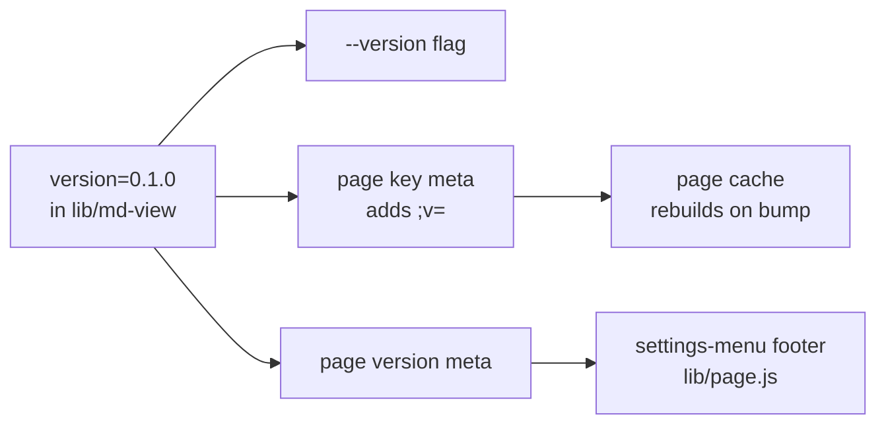

# Gate: md-view-version

_For the owner, who reads this instead of the code. One page per section. The model writes "Before build" before any task starts, and "At merge" at close-out; both go at the top of the PR._

## Before build

### What it builds
One version string, `0.1.0`, shown two ways: a `md-view --version` command-line flag,
and a muted `md-view 0.1.0` line at the bottom of the settings menu. Bumping it
rebuilds cached pages on its own.

### Parts it touches

### Contracts, data and runtime
- The written page head gains `<meta name="md-view-version" content="0.1.0">`.
- The page key meta `content` gains a trailing `;v=0.1.0` token (cache key).
- `md-view --version` writes `md-view 0.1.0` to stdout, exits 0, reads no config.
- No new tool, dependency, file, or vendored asset.

### Decisions the model made
| Decision | Alternative rejected | Why |
|---|---|---|
| One literal `version=0.1.0` in `lib/md-view` | A `VERSION` file, a git tag, `git describe` | One file the build already installs; `git describe` breaks the installed copy, which has no git. |
| Fold `;v=` into the key line | Rely on the page's file time | The key drives cache freshness; the bump invalidates deterministically, not by mtime. |
| Show it in the settings menu + `--version` | The page title bar, CLI only | The menu is the app's settings surface; the flag is the CLI convention. The title bar would crowd it. |
| `--version` before the config read | Read config, then print | The version does not depend on config; the fast path is independent of it. |

### How you'll see it working
`md-view --version` prints `md-view 0.1.0`. Open a page, click the gear, and the last
line of the popover reads `md-view 0.1.0`.

### A fresh reader's paraphrase
The story gives the tool a single version string, `0.1.0`, surfaced in two places: a
new `md-view --version` command-line flag, and a muted "md-view 0.1.0" line at the
bottom of the app's settings menu. The same string is stamped into every page the tool
writes as its own meta tag. Bumping the version doubles as cache-busting: because the
version is carried in each page's cache key, raising the number makes cached pages
rebuild themselves with no manual invalidation.

One version value lives in `lib/md-view` and feeds three consumers. The CLI flag prints
it directly. It is appended as a `;v=` token to the page's existing "key" meta, and the
page cache uses that key to decide when to rebuild. It is also written into the page
head as a separate page-version meta, which `lib/page.js` reads to render the
settings-menu footer line. So the flag and the footer are two views of one string, and
the key token is the hook that turns a bump into a rebuild.

## At merge

### What was built
As planned: one `version=0.1.0` literal in `lib/md-view`; a `--version` flag
(prints `md-view 0.1.0`, exits 0, reads no config); a `;v=0.1.0` token on the page key
meta; a `<meta name="md-view-version" content="0.1.0">` in the page head; and a muted
`md-view 0.1.0` footer in the settings popover (fallback `md-view` when the meta is
absent). Spec, README, and tests moved in step.

### Decisions changed during the build
None. Every decision in the table held through the build.

### What the reviews caught
The final review found one Important item: no DOM test for the footer's no-meta
fallback. Added as `e3d3dc8` (a meta-stripped page asserts the footer reads `md-view`).
The reviews raised five Minors, all parked as acceptable (documented in `closeout.md`).

### Run it
`md-view --version` prints `md-view 0.1.0`. Open a page, click the gear, and the last
line of the popover reads `md-view 0.1.0`. Bump the literal in `lib/md-view` and the
next run rebuilds the page (the key line changes), then reuses it.
