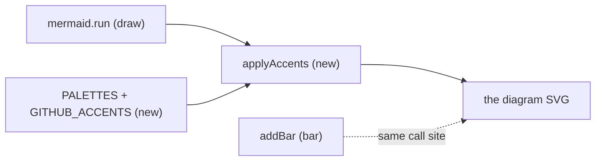

# Gate: mermaid accent coloring

_For the owner, who reads this instead of the code. One page per section. The model writes "Before build" before any task starts, and "At merge" at close-out; both go at the top of the PR._

## Before build

### What it builds

It colors the boxes, arrows, and subgraph groups of a rendered mermaid diagram with a
Tokyo accent palette, so a flow reads at a glance. Zed colors its diagram nodes the same way.
A diagram that uses `subgraph` groups gets one color per group; a flat diagram cycles colors
by position.

### Parts it touches

### Contracts, data and runtime

In the diagram: `mermaid.run` is the draw step, and `addBar` adds the Expand bar to a drawn diagram.
`PALETTES` is the page color table in `lib/page.js`. `tokyo/19` is the 19 color keys of the tokyo palette.
- New page-script data `ACCENT_KEYS` (8 keys) and `GITHUB_ACCENTS` (8 hexes per mode). No new
  palette key, so the `tokyo/19` palette count is unchanged.
- New render step in the spec ("How diagrams render", after the draw): drawn diagrams get an
  accent pass. It sets inline `style` on child shapes only; the root `<svg>` `style` is unchanged,
  and one `<svg>` stays per diagram.
- No new tool, package, flag, config key, or shell change.

### Decisions the model made
| Decision | Alternative rejected | Why |
|---|---|---|
| One hue per `subgraph`; flat diagrams cycle by position (1b) | Within-subgraph variety (1a, stride) | The owner picked mock panel E: boxes group, nodes inside stay distinct on flat. |
| Connectors take the source node's color | Neutral gray connectors | Flow reads by following one color; ~10 lines in the same pass. |
| 8-color cycle from the existing palette keys | A new 8-key palette | No new `--p-*` keys, so the `tokyo/19` test count is unchanged. |
| `fill-opacity: 0.15` over the theme background | A pre-blended hex per mode | One value, mode-independent; the accent blends over any theme background. |
| github accents = a fixed hex list in `page.js` | Read `--p-*` variables | github has no palette entry and no `--p-*` variables. |
| Cluster of a node = geometry (node center inside cluster `rect`) | DOM nesting | mermaid 12.3.0 puts `g.cluster` and `g.node` in sibling layers, not nested. |
| Sequence diagrams: color `.actor` boxes only | Color messages and lifelines too | Actors are the nodes; messages carry sequence, not grouping. |

### How you'll see it working

Open a Markdown file with a mermaid flowchart and a `subgraph`, plus a flat flowchart.
Use `md-view tests/fixtures/diagram.md` (flat, cycles colors by position) and the new
`tests/fixtures/accent-subgraphs.md` (3 subgraph groups, one hue each). Switch the palette
(`p`) and theme (`t`); the colors follow. In a browser you can also open
`mocks/mermaid-accent-options.html` and compare panel C with panel E (they match).

### A fresh reader's paraphrase
md-view renders mermaid code blocks as SVGs. This build adds a color pass over the finished SVG. It tints boxes, arrows, and subgraph group boxes from a fixed Tokyo accent palette, so a flow reads at a glance, the way Zed does. Color is assigned by group, not per node. A diagram with `subgraph` groups gives every node in a group one hue. A flat diagram cycles hues by position. An arrow inherits its source node's hue. The pass writes inline styles on the child shapes only. The root `<svg>` keeps its existing `style`, and a diagram stays one `<svg>`. Palette and theme switches re-color. No new tool, package, flag, config key, shell command, or palette key is added, so the `tokyo/19` count is untouched.

_How the parts fit:_ a new page-script function `applyAccents` is the whole feature. It runs as a render step right after mermaid's draw call. It is wired in beside the existing `addBar` call, the bar that decorates a drawn diagram. It edits the diagram's own SVG in place. Its colors come from two data tables: the existing `PALETTES` and a new `GITHUB_ACCENTS`. Both pass through a new 8-key list `ACCENT_KEYS`, so the cycle reuses keys the palettes already have. The spec's "How diagrams render" gains this step as a documented contract, and an invariant records that only child shapes get styles. Everything above the render step — the draw, the bar, the viewer, the CLI — is unchanged.

## At merge

### What was built
{{against "What it builds": same, more, or less, and why}}

### Decisions changed during the build
{{rows changed or added in the table above, with the reason; or "none"}}

### What the reviews caught
{{the findings that changed code, one line each; or "nothing that changed code"}}

### Run it
{{the command or demo, and what you should see}}
