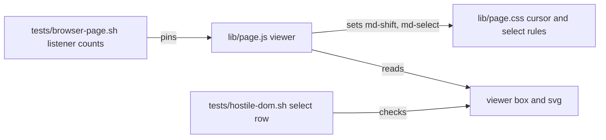

# Gate: select label text in the diagram viewer with Shift

_For the owner, who reads this instead of the code. One page per section. The model writes "Before build" before any task starts, and "At merge" at close-out; both go at the top of the PR._

## Before build

### What it builds

In the full-screen diagram view, Shift+drag selects label text, and you can copy it. A plain drag pans, as before. While you hold Shift, the cursor shows the text (I-beam) shape, so you see the mode before you drag.

### Parts it touches

### Contracts, data and runtime

Two css classes on the viewer box: `md-shift` (cursor preview, set while Shift is held) and `md-select` (select mode, set while a shift-drag runs). No new files, keys, flags or saved values. The page script gains one `keydown` and one `keyup` listener (counts pinned by tests).

### Decisions the model made

| Decision | Alternative rejected | Why |
|---|---|---|
| Shift+drag selects | A toolbar "Select" button | No new chrome; Shift is the common select-modifier in canvas tools |
| I-beam cursor while Shift is held (keydown/keyup on the dialog) | Cursor change only after the drag starts | You see the mode before you press; the dialog has focus when open, so two listeners suffice |
| Keep `zoom-in` in the in-text view | Text cursor there too | Selection already works inline; zoom-in advertises the click action |
| Two `keydown` plus one `keyup` listener; bump the pinned counts | Shift via `pointermove` on the box | Key listeners track Shift with no pointer movement; the pinned counts are explicit tests, cheap to update |

### How you'll see it working

Run `bin/md-view docs/architecture/md-view.spec.md` and click a mermaid diagram. A plain drag pans. Hold Shift, and the cursor turns to an I-beam. Shift+drag over node labels highlights text. Cmd/Ctrl+C copies it.

### A fresh reader's paraphrase
_Pasted from the fresh read before the build._

The story adds a Shift modifier to md-view's full-screen diagram viewer so a reader can highlight and copy a rendered diagram's label text: today a plain drag pans the diagram and the viewer box suppresses selection (`user-select: none`), while the inline, unexpanded diagram already selects labels. The mechanism is exactly two CSS classes on the viewer box: `md-shift`, set while Shift is held, swaps the grab cursor for a text/I-beam cursor so the mode is visible before you press; `md-select`, set on a pointerdown that starts with Shift, flips the box's computed `user-select` to `text` so native text selection runs over the SVG. The load-bearing trick in the page script is that the shift branch skips `setPointerCapture` — capture retargets pointer events and blocks native selection — and the existing drag-end/cancel/close paths remove `md-select`, so a plain drag still pans. The cursor preview comes from one keydown and one keyup listener on the modal dialog, which holds focus while open; closing the viewer clears both classes. Tests pin the shape: the browser-page suite's pinned listener counts move to two keydown/one keyup, and a new `viewer: shift preview and select mode` row in hostile-dom.sh opens the viewer, synthesizes Shift key events and shift+drag pointer events, and gates on the class plus computed cursor/`user-select` pairs (including that a plain drag pans again after the shift drag), reporting success as `<title>select=all ok</title>`. The spec sheet's viewer rows, flow item, and tests-table enumeration, plus README line 58, name the new gesture. The in-text view keeps its `zoom-in` cursor untouched, since selection already works there.

## At merge

### What was built

Same as "What it builds": Shift+drag selects label text, Shift shows the I-beam cursor, plain drag pans. No scope moved.

### Decisions changed during the build

One row added: the new test row gates select mode on `userSelect !== 'none'` (headless Chrome normalizes `text`), per the plan's stated contingency. See closeout.md.

### What the reviews caught

Nothing that changed code. One Minor: a shift-drag released over the toolbar leaves select mode on until the next pointerup on the box; it self-heals.

### Run it

Run `bin/md-view docs/architecture/md-view.spec.md` and click a mermaid diagram. A plain drag pans. Hold Shift, and the cursor turns to an I-beam. Shift+drag over node labels highlights text. Cmd/Ctrl+C copies it. `make check` exits 0.
