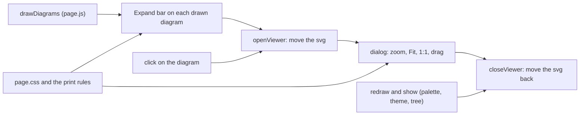

# Gate: mermaid-viewer

_For the owner, who reads this instead of the code. The model writes "Before build" before any task starts, and "At merge" at close-out. Both go at the top of the PR._

## Before build

### What it builds

Each drawn mermaid diagram gets a small Expand button in its top-right corner. The button, or a click on the diagram, opens the diagram in a full-screen viewer. The viewer always opens in Fit: the full diagram fills the window. In the viewer you zoom with the wheel, the buttons or the keys, and you drag the diagram to move it. The page itself never zooms.

### Parts it touches



### Contracts, data and runtime

- Words on this page: `page.js` and `page.css` are the page script and style. `drawDiagrams` draws the diagrams. `redraw` draws them again after a palette or theme change. `show` puts a file into the page (a tree click). Fit is the zoom that shows the full diagram in the viewer. The page keys are `t` theme, `s` palette, `w` width, `b` file tree and `?` help.
- New page parts: the bar `.md-dbar` in each drawn diagram, and one `<dialog class="md-viewer">`.
- New keys, in the viewer only: `+` or `=` zoom in, `-` zoom out, `0` Fit, `1` actual size, Esc close. While the viewer is open, the page keys `t s w b ?` do nothing.
- Print hides the bar.
- No change to the CSP, the mermaid security level, the pinned mermaid script, the flags, the config keys or the install. No new file and no library.
- Nine new rows in `tests/hostile-dom.sh`. They need the mermaid CDN, so they skip with no network.

### Decisions the model made

| Decision | Alternative rejected | Why |
|---|---|---|
| Zoom step 1.25. Zoom range 0.05 to 20, for all zoom (Fit too). | No range, or a cap at 1 | The owner said Fit has no cap at 1. A range stops a zoom to an empty box. |
| The wheel zooms by `1.25^(−deltaY/100)`, so one mouse wheel step is one 1.25 step. | A fixed step for each wheel event | A trackpad pinch sends many small events. One formula gives a smooth pinch and a normal wheel step. |
| The buttons and the keys zoom at the box center. The wheel zooms at the pointer. | All at the pointer | A key or button has no pointer point. |
| At open, the viewer copies the font, the size and the line height of the diagram block. | Fixed CSS values that copy the GitHub style | Labels then keep the same layout in each palette and width. There are no values to keep in step. |
| One click listener on the content, not one for each diagram. | A listener on each block | A redraw keeps the block, so a listener on each block would be added twice. |
| The dialog is made at the first open and kept. | Make it at page load | A page with no diagram gets no dialog. |
| A window resize does not change the zoom. | Fit again at each resize | The reader keeps the zoom that they chose. Key `0` fits again. |
| Button text `⤢` for Expand, and `−`, `+`, `Fit`, `1:1`, `×`, each with a label for screen readers. | Icons from a font or an image | No new file and no CSP change. |
| The tests read the result from the page title, with the fixture that has one failed and one drawn diagram. | A new browser test tool | The tests already work this way. A probe proved that the dialog works in the headless dump. |
| Key `=` zooms in too, as `+` does. | Only `+` | On many keyboards, `+` needs Shift. |
| A wheel that sends lines (`deltaMode` 1, as Firefox can) counts each line as 33 px. The backdrop is black at 50 % in all palettes, because the dialog fills the window and the backdrop does not show. | Ignore line mode | Without it, one Firefox wheel step zooms almost nothing. |
| The `<svg>` goes back only into a `pre` that still has the same bar node as at the open. Else it is dropped. | Put it back in any `pre` with no `<svg>` | A redraw empties the `pre` later than the close. A new drawing gets a new bar, so the old bar shows that the `pre` did not change. |
| Three tasks: the bar and open and close, then zoom and keys, then the close on redraw. | One task | Each task has its own rows that fail first. The first task is the risky part and gets the critical review. |

### How you'll see it working

Run `make check`. Then run `bin/md-view` on a file with a big diagram. Point at the diagram, click the Expand button, zoom with the wheel and drag. Press Esc. Then do the manual check in Chrome, Firefox and Safari. Check the wheel zoom at the pointer, the pinch, the drag, the bar on hover, Esc and the focus after close.

### A fresh reader's paraphrase

_Pasted from the fresh read before the build._

> **What this builds**
>
> Each drawn mermaid diagram gets a small Expand button in its top-right corner. A click on the button, or a click on the diagram, opens that diagram in a full-screen viewer. In the viewer, the user zooms with the mouse wheel, the buttons or the keys. The user drags the diagram to move it. The page itself does not zoom.
>
> **How the parts fit, per this page**
>
> drawDiagrams in page.js adds the Expand bar to each drawn diagram. The bar and a click on the diagram both call openViewer, which moves the svg into a dialog. The dialog has zoom, Fit, 1:1 and drag. closeViewer moves the svg back. Redraw and show (palette, theme, tree) also call closeViewer. page.css styles the bar and the dialog. The print rules hide the bar.
>
> Gap: gate.md does not say what zoom level the viewer uses when it opens. plan.md (T3 README text) says "opens in Fit", but the gate does not.

The reader listed 29 terms and 11 open choices. The gate now defines the page words and says that the viewer opens in Fit. The spec settled the open choices already, and the plan now sends the implementer to each spec section. The reader saw a conflict about the commit trailer. It is not a conflict: the plan sets the project trailer for each model.

## At merge

### What was built

As planned. Each drawn diagram gets a small bar with an Expand button. A click on Expand or on the diagram opens a viewer that fills the window. The viewer opens in Fit. It has the buttons `−`, `+`, `Fit`, `1:1` and `×`, and the keys `+ = - 0 1` and Esc. The wheel zooms at the pointer, and a drag pans. On close, the diagram goes back into the page. A theme or palette change, and a move to another file, close the viewer first. The code is in `lib/page.js` and `lib/page.css`, and both print rules hide the bar. `tests/hostile-dom.sh` has ten new `viewer:` rows.

### Decisions changed during the build

| Decision | Before | Why |
|---|---|---|
| The dialog size is `width: 100%; height: 100%` | `100vw` and `100vh` | With a page scroll bar, `100vw` made the dialog wider than the window (final review). |
| The viewer keys are in the one page `keydown` handler | a `keydown` listener on the dialog | `tests/browser-page.sh` pins one `keydown` listener. The behavior is the same. |
| Ten test rows | nine | A review added a row that proves the drag pans and a drag on the scroll bar does not. |
| The close row sends the `close` event itself after `dialog.close()` | the native event | Headless Chrome does not give the native event to the page. A copy with no close listener fails the row. A person checks the real Esc. |
| The `×` button has the focus at open | no rule | The keyboard user can close at once. |

### What the reviews caught

- Final review, Important: the dialog was wider than the window on a page with a scroll bar. Fixed, and a new low-window test fails on the old CSS.
- Final review, Minor: the Fit test did not cover a low window, where the height limits the zoom. Fixed with the same low-window test.
- Task reviews: the Fit test was too weak, the focus at open, and a drag that started on the scroll bar. All fixed in T2.
- Parked: no test proves that a move to another file closes the viewer, and print while the viewer is open prints the dialog. Both are in `closeout.md`.

### Run it

```sh
make check
bin/md-view tests/fixtures/broken-diagram.md
```

`make check` prints `all checks pass`, with ten `ok viewer:` rows and no `skip` line. In the page, point at the drawn diagram and click Expand. Then use the wheel, a drag, `+`, `-`, `0`, `1` and Esc. Check this in Chrome, Firefox and Safari.
