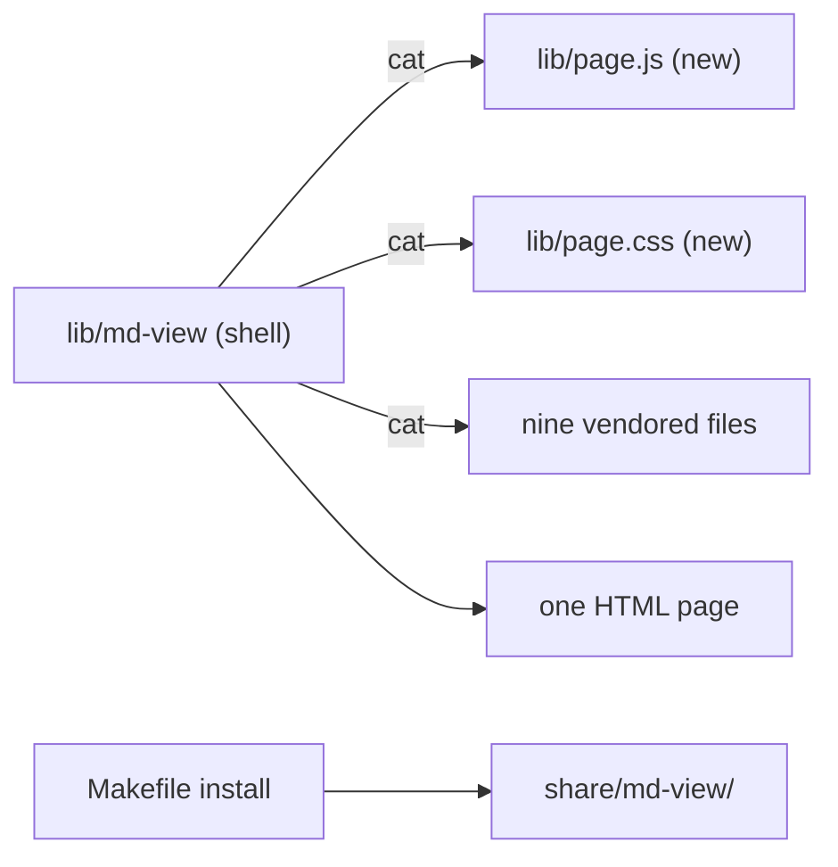

# Gate: page-assets

_For the owner, who reads this instead of the code. The model writes "Before build" before any task starts, and "At merge" at close-out. Both go at the top of the PR._

## Before build

### What it builds

The page script (about 890 lines) and the main page style (about 60 lines) move out of the shell script `lib/md-view` into `lib/page.js` and `lib/page.css`. The written page does not change, byte for byte.

### Parts it touches



### Contracts, data and runtime

- The install tree gets two more files: `share/md-view/page.js` and `share/md-view/page.css`.
- Exit 3 means "a file that the page needs is missing". Today it covers the vendored files. It now also covers a missing `page.js` or `page.css`, with the message `md-view: cannot find <name>`.
- md-view keeps a cache page for each Markdown file and opens it again when no input is newer (the page reuse rule). The two new files become inputs of that rule, so an edit to them gives a new page.
- The written page, the flags, the config keys and the page behavior do not change.

### Decisions the model made

| Decision | Alternative rejected | Why |
|---|---|---|
| Two files, `page.js` and `page.css` | One file per part of the page script | The story only moves code. A split of the page script has no user now (YAGNI). |
| The tree-only style and the one-file print rule stay heredocs | Two more CSS files, or one CSS file with both | They sit in a shell `if` and are about 30 lines. More files add install and test lines for no gain. |
| A new `PAGE` list in `Makefile` | Add the files to `VENDORED` | The files are md-view code, not vendored. The vendored rules (license file, no edits) must not apply to them. |
| The byte-identical proof runs once as the T1 done check, against `origin/main` | A permanent test that compares with an old commit | After the merge, the old script is history. A permanent test would pin the old page and fail on the next real change. |
| The existing exit 3 test and the reuse test get the two names, from a new list `page_code` | New test cases, or the names in the `vendored=` list | The current cases already loop over a list of files. The `vendored=` list also feeds a vendored-only rule (no `<!--`), which `page.js` breaks. |
| One task | Two tasks (move, then install) | The install test fails until the install lists the new files, so the move and the install must land together. |

### How you'll see it working

Run `make check`. Then run `md-view` on any Markdown file. The page looks and acts as before. `ls lib` shows `page.js` and `page.css`.

### A fresh reader's paraphrase

_Pasted from the fresh read before the build._

> The page script (about 890 lines) and the main page style (about 60 lines) move out of the shell script `lib/md-view`. They go into two new files, `lib/page.js` and `lib/page.css`. The page that md-view writes stays the same, byte for byte. The flags, the config keys and the page behavior do not change.
>
> md-view runs `cat` on the two new files and on the nine vendored files, and the result is one HTML page. The Makefile install step copies the two new files into `share/md-view/`, beside the vendored files. If `page.js` or `page.css` is missing, md-view exits with code 3 and prints `md-view: cannot find <name>`. A "page reuse rule" also watches the two new files.

The reader said that the page did not define the reuse rule or exit 3. The "Contracts" section now defines both. The plan now settles the ten open choices from the reader. Examples are the line ranges, the test lists and the README text.

## At merge

### What was built

As planned. The page script moved to `lib/page.js` (35 KB) and the main page style to `lib/page.css` (6 KB). `lib/md-view` writes them with `cat`. `make install` installs them with mode 644. A missing file gives exit 3. A newer file makes md-view write the page again. The written page is byte-identical to `origin/main` for each fixture, in tree mode and in one-file mode.

### Decisions changed during the build

none

### What the reviews caught

Nothing that changed code. The final review found one doc gap: the spec Install row and the `AGENTS.md` vendored-files rule did not name the page files. The close-out fixed both. Three Minor findings are parked in `closeout.md`.

### Run it

```sh
make check
ls lib/page.js lib/page.css
bin/md-view README.md
```

`make check` prints `all checks pass`. The page looks and acts as before.
