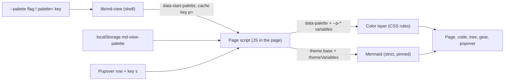

# Gate: themes-tokyo-night

_For the owner, who reads this instead of the code. One page per section. The model writes "Before build" before any task starts, and "At merge" at close-out; both go at the top of the PR._

## Before build

### What it builds
md-view gets a new setting, `palette`, with the words `github` (today's look) and `tokyo`. Tokyo is Tokyo Night in the dark mode and Tokyo Day in the light mode. The palette colors the page text, the code blocks, the mermaid diagrams, the left file tree, the gear and the popover.

### Parts it touches

### Contracts, data and runtime
- **New flag:** `--palette github|tokyo`. A bad word gives usage and exit 2.
- **New config key:** `palette=` in `[View]` of `config.ini`. A bad value is ignored.
- **New page attribute:** `data-start-palette` in the `html` tag, always present. `data-palette` appears only for `tokyo`.
- **Changed cache key:** the `md-view-key` line gets `p=<word>`. Old cache pages are built again once.
- **New saved key:** `md-view-palette` in `localStorage`.
- **New key `s`.** A new popover row `Style`. The keys line in the popover changes: `Keys: t theme, s style, w width, b tree, ? help`.
- **New data:** a table of 19 colors for Tokyo Day and Tokyo Night, from the official `folke/tokyonight.nvim` files (commit `cdc07ac`). The source repo has the Apache 2.0 license. The page copies color values only, and no code.
- **No change:** the `theme` setting and its three words, the CSP meta, mermaid `securityLevel:'strict'`, the pinned mermaid script and its SRI hash, every vendored file. No new tool or file in `lib/`.

### Decisions the model made
| Decision | Alternative rejected | Why |
|---|---|---|
| The palette is a second setting. The mode keeps its three words. | New words `tokyo-night` and `tokyo-day` in `theme`. | You said more palettes will come. Each new palette would add two words, and `auto` could not follow the system. |
| The setting is called `palette`. | `style`, `scheme`. | `style` already names the GitHub style in the spec. `scheme` clashes with CSS `color-scheme`. You may rename it before the build. |
| The color table is in the page script. It sets CSS variables on `html`. | The shell writes one stylesheet for each palette and mode. | The page switches palette and mode with no reload. One table gives the page, the code and the diagrams their colors. |
| `github` is "no layer". The vendored styles show as today. | Write GitHub as a palette too. | It would risk a change of today's look, and it would add rules for no gain. |
| The Tokyo rules are one layer on top of the vendored styles. Each rule starts with `html[data-palette]`. | Edit the vendored CSS, or add `!important`. | The vendored files stay unmodified. The higher specificity wins with no `!important`. |
| Code token colors are rules that come from the palette table. | Vendor a highlight.js Tokyo style file. | No new vendored file, no license change, and the code colors always match the page colors. |
| Mermaid for Tokyo uses `theme:'base'` and `themeVariables` from the same colors. | A second color table for mermaid. | One source of colors. Strict mode and the pinned script stay. |
| Borders use the source key `fg_gutter`, not the source key `border`. | The source `border`. | In Night the source `border` (`#15161e`) is almost the page color. Borders would not show. |
| The `html` tag always has `data-start-palette`. Tests change with it. | Add the attribute only for `tokyo`. | One rule with no special case. The cost is a change in the tests that check the exact tag. |
| The popover row is `Style`, as in the mock page you saw. The setting is `palette`. The mode row keeps the name `Theme`. | Name the row `Palette`, or rename the mode row `Mode`. | The story and the mock say `Style`. A rename of the mode row changes today's text and tests, and gains little. |
| The tree panel, the gear and the popover follow the palette. | Leave them in system colors. | You asked for the tree. The popover and the gear are one family with it. |
| A rule test checks that each themed part has a layer rule. Your eyes judge the colors, on screenshots. | A test that reads real pixel colors or the contrast. | A pixel test needs a new tool. The layer test catches a lost rule, and you see the rest. |
| Few tests: one for the setting, one for the cache key, one for the layer, three page rows and the mermaid rows. | A test row for each line of the spec. | You asked for focused tests. The rows left out keep the code of today. |
| Alert boxes, images and footnotes of the Markdown style keep their GitHub colors. | Restyle them now. | Marked draws none of them today, and the layer would hold rules that nothing tests. |
| The two spikes of the brief (mermaid coverage, rule count) became the real run of the last task. You see the shots after the build. | A spike with your look before the spec. | You waived the stop before the build. The mock page you saw already shows the colors. |
| The current file in the tree uses the `bg-visual` color. | The `bg-hl` color. | In Day, `bg-hl` is almost the panel color. `bg-visual` shows the file in Day and in Night. |
| The work is in the worktree `.worktrees/themes-tokyo-night`. | A branch in place. | You asked for it. The script that measures the cost of the build also looks for that worktree path. |
| Close-out prepares the branch and the PR text, and does not push. | A draft PR at close-out. | AGENTS.md says no push without your word. |

### Terms used on this page
- **Mode:** the existing `theme` setting. Its three words are `light`, `dark` and `auto`.
- **Tokyo Night and Tokyo Day:** the dark and the light version of the `tokyo` palette.
- **Source key:** the name of a color in the official Tokyo files, such as `fg_gutter`. `spec.md` maps each one to a page key.
- **`md-view-key` line:** a meta line in the page head. It holds the settings of one run. The script reuses a cache page only if the line matches.
- **`data-palette`:** an attribute of the `html` tag. The color layer reads it.
- **`--p-*` variables:** CSS variables on the `html` tag. Each holds one color of the used palette and mode.
- **Color layer:** CSS rules that start with `html[data-palette]`. They override the colors of the vendored styles.
- **Vendored styles and files:** the GitHub and highlight.js files in `lib/`. They stay as they come from their source.
- **CSP meta, `securityLevel:'strict'`, pinned script and SRI hash:** the security rules of AGENTS.md. They stay as they are.
- **`themeVariables` and `theme:'base'`:** the mermaid settings that carry custom colors.
- **Gear and popover:** the settings button at the top right of the page and the box that it opens.
- **Close-out:** the last step of the story, where the main session writes the "At merge" half, the cost record and the durable doc changes.

### How you'll see it working
1. `sh lib/md-view --palette tokyo --theme dark --no-open --out /tmp/t.html tests/browser-page/sample.md`, then open `/tmp/t.html`. The page is Tokyo Night. Press `s` to go back to GitHub. Press `t` to change the mode.
2. Open the screenshots in `.build/shots/` (the list is in the final report). They show Night, Day and GitHub, for the sample page with the tree and for six diagram types.
3. `make check` passes.

### A fresh reader's paraphrase
_Pasted from the fresh read before the build._

**What this builds**
md-view gets a new setting named `palette`. It has two words. `github` keeps today's look. `tokyo` uses Tokyo Night colors in dark mode and Tokyo Day colors in light mode. The palette sets the colors of the page text, the code blocks, the Mermaid diagrams, the left file tree, the gear and the popover.

**How the parts fit, per this page**
The `--palette` flag or the `palette=` key in `config.ini` sets the palette. The shell script `lib/md-view` puts the word into the page as `data-start-palette`, and into the cache key. The page script reads that start word and any saved choice in `localStorage`. The popover row and the key `s` can change the palette. The page script then sets `data-palette` and the `--p-*` CSS variables, which feed a CSS color layer. It also gives Mermaid the same colors through its theme settings.

_Fixed after the read: the worktree row now says what measures the cost, and the page has a terms list._

## At merge

### What was built
_Written at close-out._

### Decisions changed during the build
_Written at close-out._

### What the reviews caught
_Written at close-out._

### Run it
_Written at close-out._
