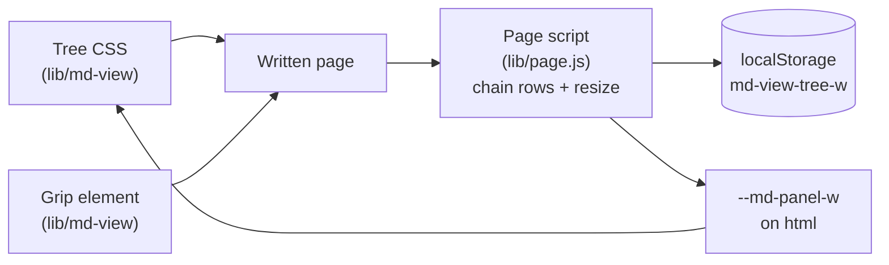

# Gate: tree-panel-compact-resize

_For the owner, who reads this instead of the code. One page per section. The model writes "Before build" before any task starts, and "At merge" at close-out; both go at the top of the PR._

## Before build

### What it builds
The file tree on the left gets visible depth. Each level gets a guide rail, a chevron, and a bold folder name. A folder chain of single folders takes one row. Long names end with an ellipsis.
The panel starts 300 px wide. The reader can drag it wider, or use the keys. The page keeps the width across reloads.

### Parts it touches

### Contracts, data and runtime
- `localStorage` key `md-view-tree-w`: a string of 1 to 4 digits (pixels). The page clamps it to 200..560 and to at most half the window. Reset removes it.
- New custom property `--md-panel-w` on `html`, default 300 px; it drives the panel, the gutter, the toggle, and the grip.
- New DOM element `#md-tree-resize` (a focusable separator) in tree mode only.
- Tree panel DOM changes: nested folder boxes, a `›` inside chain summaries, ellipsis styles. `data-panel`, `data-tree`, `data-root`, the toggle, and all link hrefs are unchanged.

### Decisions the model made
| Decision | Alternative rejected | Why |
|---|---|---|
| 300 px default panel width | Keep 260 px | The mock's own arithmetic uses the 300 px gutter (332/316/308 constants). |
| Chain rows: folder → single folder child collapses to one `deep › a` row | Breadcrumb row (card D); keep all rows (card A) | One row per chain reads depth best in a narrow panel; the owner picked C. |
| Grip is a sibling of the nav, fixed at the panel edge | Grip inside the scrolling panel | `overflow: auto` on the panel clips an inside grip. |
| Grip keys through `onkeydown` assignment | A third `addEventListener('keydown'` | `tests/browser-page.sh:899` pins the keydown listener count to 1. |
| Print and narrow: grip on new lines beside the pinned lines | Extend the pinned lines | The pinned lines stay verbatim (`tests/browser-page.sh:2684,2695,2697`). |
| Chevron `›` glyph, rotated 90° when open | Native triangle; `▾` content swap | Crisp at 13 px, one animated rule; the mock proved it. |
| `--md-panel-w` set inline on `html` by the script | Rewrite `#md-tree-panel { width }` | One property drives panel, gutter, toggle, and grip together. |
| Saved value is a plain pixel number string | Store `420px`; store the "wide" word | Parses with one regex; matches the width-key style. |
| Ellipsis, no `title` tooltips | Tooltips on clipped names | The pinned links-dom rows match bare `<a href="#/...">name</a>`. |

### How you'll see it working
From the repo root run `bin/md-view README.md`. The panel lists the repo tree. Drag the grip on the right edge of the panel. Focus it and press `→` and `⇧→`. Double-click resets it to 300 px. Reload to see the saved width.
The screenshots in `closeout.md` show the deep fixture at default, dragged, and keyboard-widened, in both palettes.

### A fresh reader's paraphrase
_Pasted from the fresh read before the build._

## At merge

### What was built
{{against "What it builds": same, more, or less, and why}}

### Decisions changed during the build
{{rows changed or added in the table above, with the reason; or "none"}}

### What the reviews caught
{{the findings that changed code, one line each; or "nothing that changed code"}}

### Run it
{{the command or demo, and what you should see}}
