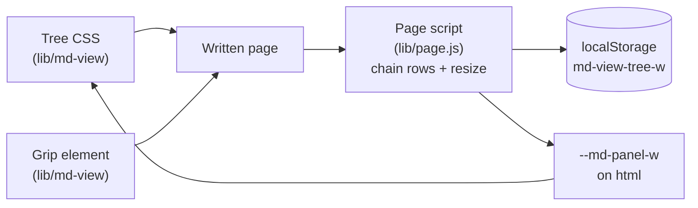

# Gate: tree-panel-compact-resize

_For the owner, who reads this instead of the code. One page per section. The model writes "Before build" before any task starts, and "At merge" at close-out; both go at the top of the PR._

## Before build

### What it builds
The file tree on the left gets visible depth. Each level gets a guide rail, a chevron, and a bold folder name. A folder chain of single folders takes one row. Long names end with an ellipsis.
The panel starts 300 px wide. The reader can drag it wider, or use the keys. The page keeps the width across reloads.

### Parts it touches

### Contracts, data and runtime
- `localStorage` key `md-view-tree-w`: a string of 1 to 4 digits (pixels). The page clamps it to 200..560 and to at most half the window. Reset removes it.
- New custom property `--md-panel-w` on `html`, default 300 px; it drives the panel, the gutter, the toggle, and the grip.
- New DOM element `#md-tree-resize` (a focusable separator) in tree mode only.
- Tree panel DOM changes: nested folder boxes, a `›` inside chain summaries, ellipsis styles. `data-panel`, `data-tree`, `data-root`, the toggle, and all link hrefs are unchanged.

### Decisions the model made
| Decision | Alternative rejected | Why |
|---|---|---|
| 300 px default panel width | Keep 260 px | The mock's own arithmetic uses the 300 px gutter (332/316/308 constants). |
| Chain rows: folder → single folder child collapses to one `deep › a` row | Breadcrumb row (card D); keep all rows (card A) | One row per chain reads depth best in a narrow panel; the owner picked C. |
| Grip is a sibling of the nav, fixed at the panel edge | Grip inside the scrolling panel | `overflow: auto` on the panel clips an inside grip. |
| Grip keys through `onkeydown` assignment | A third `addEventListener('keydown'` | `tests/browser-page.sh:899` pins the keydown listener count to 1. |
| Print and narrow: grip on new lines beside the pinned lines | Extend the pinned lines | The pinned lines stay verbatim (`tests/browser-page.sh:2684,2695,2697`). |
| Chevron `›` glyph, rotated 90° when open | Native triangle; `▾` content swap | Crisp at 13 px, one animated rule; the mock proved it. |
| `--md-panel-w` set inline on `html` by the script | Rewrite `#md-tree-panel { width }` | One property drives panel, gutter, toggle, and grip together. |
| Saved value is a plain pixel number string | Store `420px`; store the "wide" word | Parses with one regex; matches the width-key style. |
| Ellipsis, no `title` tooltips | Tooltips on clipped names | The pinned links-dom rows match bare `<a href="#/...">name</a>`. |

### How you'll see it working
From the repo root run `bin/md-view README.md`. The panel lists the repo tree. Drag the grip on the right edge of the panel. Focus it and press `→` and `⇧→`. Double-click resets it to 300 px. Reload to see the saved width.
The screenshots in `closeout.md` show the deep fixture at default, dragged, and keyboard-widened, in both palettes.

### A fresh reader's paraphrase
**Reader's view.** The file tree panel shows depth visually. Each nesting level carries a guide rail. Folders get a chevron that rotates on open, and a bolder weight. Long names cut off with an ellipsis on a single line.
A folder chain collapses onto one row. A chain is folders that each contain exactly one subfolder. The names on the row are joined by a `›` separator. The file under the chain lives in that one expandable box.
A thin full-height grip sits on the panel's right edge. The reader drags it to widen the panel, or nudges it with the Arrow keys (16 px, 64 px with Shift). A double-click snaps back to 300 px. The page remembers the width (localStorage key `md-view-tree-w`, clamped 200-560 px and to half the window) and re-applies it on the next load. Reset clears it. Below 700 px, in print, and when the panel is closed, the panel, the toggle, and the grip hide.
**Order of work.** The rules of T1 (CSS, grip markup, page-test pins) are what the DOM tests measure, so T1 comes first. T1 verifies without touching `lib/page.js`.
T2 (chain rows in `buildTree`) follows. Its DOM tests use the moved geometry constants, which take effect once the CSS is in. T3 (resize) wires onto the grip markup and the finished tree, in the same files. T4 (durable docs) comes after behavior is frozen, because the doc rows are grep-pinned by tests. T5 runs the full `make check` and the screenshots.
**Proof.** T1 runs `bash tests/browser-page.sh`. T2 and T3 run `bash tests/browser-links-dom.sh`. Chain summaries are pinned by literal serialized strings.
The resize cases drive the page with synthetic scripts and gate on the title. The key chain asserts `316px 316 380px 380 364px 364`. The drag asserts `360 360`, then `300 300` after a double-click. The seed cases assert painted widths 400, 560, 200, 300, and the 450 half-window cap. T4 runs `check_ste.py`. T5 runs `make check` and posts screenshots.
**Findings and rulings (fresh read).** (1) The story said init runs after `buildTree`; the plan said before. Ruling: before. The story line now says so. (2) "A tenth ArrowRight clamps at 560" was off - it reaches 460. The story now says successive presses clamp. The seed cases test the 560 and 200 clamps and the half-window cap. (3) The drag row moved to 60 px, `ArrowLeft` tests 380→364, and a new `case_dom_panel_reset` case covers Reset. (4) Synthetic drag is the acknowledged flaky part; the key and seed cases are the primary gates. (5) The chain pins are fixed to the serialization above; the first dump confirms them.

## At merge

### What was built
Same, plus one addition from the final review: the grip hides with a closed panel (one CSS rule and one page-test pin).

### Decisions changed during the build
None. Two build rulings kept the plan. The grip keys use element `onkeydown` assignment. That keeps the keydown-listener pin at 1. The `overflow-wrap` grep move is a no-op, because no such pin exists. `.md-root` keeps its long-name safety net.

### What the reviews caught
T3 Critical: the links-dom run loop replaced three pre-existing cases with the four new ones; the run loop now lists all seven (58a6314). Final review Minor: the grip stayed visible and draggable with a closed panel; a closed-state hide rule and pin fix it (3d32552).

### Run it
`bin/md-view --tree docs/stories/tree-panel-compact-resize/shots` — drag the right edge, press `ArrowRight` and `Shift+ArrowRight`, double-click the grip; the width saves. `docs/stories/tree-panel-compact-resize/shots/` holds six screenshots (github and tokyo palettes; default, drag, keys).
