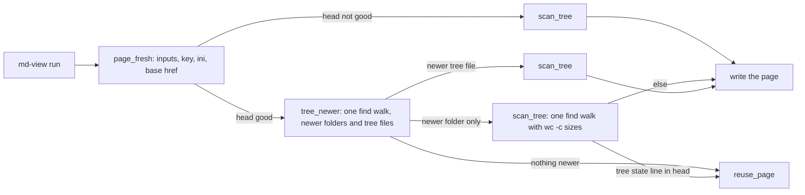

# Gate: tree-scan-speed

_For the owner, who reads this instead of the code. The model writes "Before build" before any task starts, and "At merge" at close-out. Both go at the top of the PR._

## Before build

### What it builds
A tree page on a large folder opens faster. When nothing in the tree changed, md-view reuses the cached page after one `find` walk, with no scan and no file read. A new page scans the tree in one walk and takes the file sizes from `wc -c`, not from a read of each file. The written page does not change.

### Parts it touches

- `page_fresh`, `scan_tree` and the main flow in `lib/md-view`. New small functions `tree_newer` and `reuse_page`.
- `tests/browser-page.sh`: three new rows. `tests/bench.sh`: new, outside `make check`.
- Spec rows "Reuse", "Inputs", "Files in the page", "Shell tools", and the Tests table.

### Contracts, data and runtime
- No change to a flag, a key, the page bytes, the `--list-tree` output or the tree state line.
- One exception in sizes: a file with no final newline now counts 1 byte less. A file within a few bytes of the 8 MiB limit can change from `cut` to `page`.
- New runtime tool: `wc` (POSIX). It goes into the spec "Shell tools" row.
- The cache check in tree mode now also needs the `<base href>` line of this root in the page head. The line is in every tree page today, so no old page breaks.

### Decisions the model made
| Decision | Alternative rejected | Why |
|---|---|---|
| Get paths and sizes from one walk: `-print` and `-exec wc -c {} +` together, lines told apart by their start (`./` or a number). | Take the path list from the `wc` lines only. | A file that `wc` cannot read gives no `wc` line and would drop out of the tree. Today it stays as an empty `page` file. |
| The opened file size comes from `wc -c < file`. | Take it from the walk. | The opened file can be outside the walk (hidden, too deep, in `node_modules`). |
| The fast check also compares the `<base href>` line of the page head with this root. | Trust the walk alone. | With `root=repo`, a removed `.git` moves the root to a sub-folder that has nothing newer. The walk alone would reuse a page of the old root. |
| The newer walk adds folders with `-o -type d -newer` behind the `scan_find` arguments. | A second copy of the skip rules for the newer walk. | One copy of the skip rules. A second copy can become different. |
| A newer path is a tree file when `[ -f ]` holds for it. | Mark the folder lines in the `find` output. | POSIX `find` has no `-printf`. The newer list is short in normal use. |
| A reuse after a full scan leaves the page time as it is. | Touch the page, so the next run takes the fast path. | A touch can hide an edit made between the scan and the touch. The next run only does the full scan again, which is the speed of a new walk, not a bug. |
| Keep the `-newer` check strict and by time only. | Add a content hash. | Same rule as today (spec "Limits"). macOS and GNU `find` compare in nanoseconds. |

### How you'll see it working
1. Run `sh tests/bench.sh`. It prints `new page: … s` and `cached page: … s` on a tree of 3,000 files.
2. Run `make check`. The rows `cache_tree_one_walk`, `cache_tree_grown_big` and `cache_tree_root_moved` pass.

### A fresh reader's paraphrase
_Pasted from the fresh read before the build._

**What this builds.** A tree page of a large folder opens faster. If nothing in the tree changed, md-view reuses the cached page after one `find` walk. It does not scan the tree or read a file. When md-view builds a new page, it scans the tree in one walk. It gets each file size from `wc -c`, not from a read of each file. The written page does not change.

**How the parts fit.** A run of md-view starts with `page_fresh`. It checks the page head: the inputs, the key, the ini line and the base href. If the head is good, `tree_newer` runs one `find` walk and lists the newer folders and tree files. If nothing is newer, `reuse_page` reuses the page. If only a folder is newer, `scan_tree` runs one walk with `wc -c` sizes. The page is reused if its head has the tree state line of that scan. Otherwise md-view writes the page. If a tree file is newer, md-view scans and writes the page.

The reader found one gap: the diagram had no branch for a head that is not good. The diagram now has it (scan, then build). The reader's ten open choices are settled in `plan.md`.

## At merge

### What was built
{{against "What it builds": same, more, or less, and why}}

### Decisions changed during the build
{{rows changed or added in the table above, with the reason; or "none"}}

### What the reviews caught
{{the findings that changed code, one line each; or "nothing that changed code"}}

### Run it
{{the command or demo, and what you should see}}
