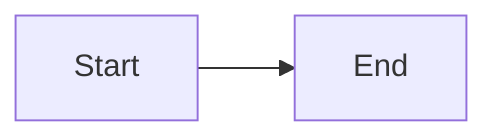

# Sample for the browser page

Plain text with `inline code`, **bold** and a [link](https://example.com).

| Width | Theme |
|---|---|
| 60 | light |
| 70 | auto |
| 80 | dark |

- [x] A done task
- [ ] An open task

```js
function add(a, b) { return a + b; }
```

```python
def add(a, b):
    return a + b
```

```sh
for f in *.md; do echo "$f"; done
```

```
A fence with no language stays plain.
```


